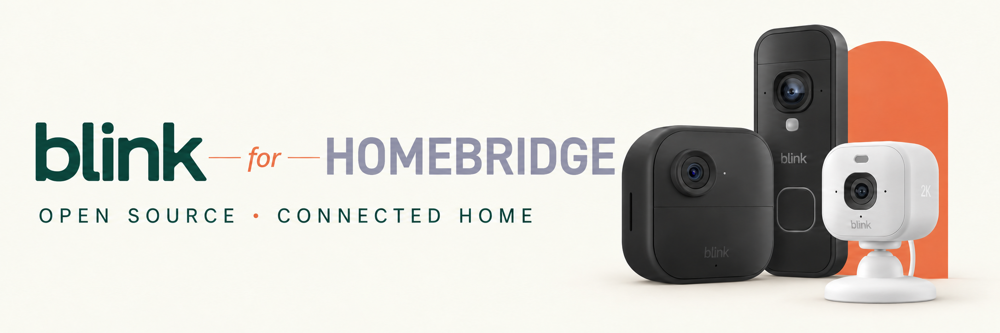

# Homebridge Blink Cameras

Bring Blink cameras into Apple Home for live viewing, motion controls and optional
recording from completed native Blink clips.

`@sealad886/homebridge-blink-cameras-new-api` · Unofficial community plugin

Last reviewed: 16 November 2026.

[](https://www.npmjs.com/package/@sealad886/homebridge-blink-cameras-new-api)
[](LICENSE)
[](https://github.com/sealad886/homebridge-blink-cameras-new-api/actions/workflows/test.yml)
[](https://codecov.io/gh/sealad886/homebridge-blink-cameras-new-api)

**[Read the documentation](https://sealad886.github.io/homebridge-blink-cameras-new-api/)**
· [Configuration](https://sealad886.github.io/homebridge-blink-cameras-new-api/configuration/)
· [Troubleshooting](https://sealad886.github.io/homebridge-blink-cameras-new-api/troubleshooting/)
· [Download the offline guide](https://sealad886.github.io/homebridge-blink-cameras-new-api/offline.html)

> Important: This plugin uses Blink's private OAuth and REST APIs. All APK-known
> production regions use the same production OAuth host; geography changes only
> the REST tier discovered after token issuance. Only an EU-region account has
> live-account evidence. Non-EU accounts are not live-validated and remain covered
> by Android 57.1 APK traces plus automated routing tests.

Modern Blink platform plugin for Homebridge using Blink-hosted OAuth. Exposes Blink devices as proper HomeKit accessories:

- **SecuritySystem** for arm/disarm control of networks
- **MotionSensor** for authenticated Blink push motion events
- **Doorbell** service exposed for doorbell devices; automatic ring delivery is not implemented
- **Switch** for enabling/disabling motion detection per device
- **Camera** live video/audio and snapshots, with an optional manual snapshot-refresh switch
- **Opt-in HomeKit Secure Video** from completed native Blink USB clips, delivered
  through each camera’s existing Home accessory; see the per-camera setup below
- **Connection monitor and retry control** for provider outages
- **Optional TemperatureSensor** for traditional cameras reporting temperature;
  default off, with global and per-device settings

The current static API catalog is recovered from Blink Android 59.2
(`versionCode` 29823413), with Android 57.1 retained as the comparison and
bounded live-evidence baseline. See the [API contract](https://github.com/sealad886/homebridge-blink-cameras-new-api/blob/main/docs/api-contract/README.md). Blink can
change these private interfaces without notice.

## Contents

- [Features and supported devices](#features-and-supported-devices)
- [Requirements](#requirements)
- [Installation](#installation)
- [Sign-in and account verification](#sign-in-and-account-verification)
- [Configuration](#configuration)
- [Using the plugin in Apple Home](#using-the-plugin-in-apple-home)
- [Live streaming and quality](#live-streaming-and-quality)
- [HomeKit Secure Video](#homekit-secure-video)
- [Troubleshooting](#troubleshooting)
- [Documentation and development](#documentation-and-development)
- [Disclaimer and trademarks](#disclaimer-and-trademarks)

## Features and supported devices

- ✅ **Proper HomeKit SecuritySystem** - Arm/disarm networks using the Security System tile in Home app
- ✅ **Motion Detection** - Receive motion alerts in HomeKit when your cameras detect motion
- **Doorbell devices** - Motion controls, sensors and a HomeKit Doorbell service; see the ring-event limitation below
- ✅ **Status Polling** - Automatically syncs device states with Blink cloud
- ✅ **OAuth Authentication** - Modern OAuth 2.0 with automatic token refresh
- ✅ **Blink-hosted MFA** - Password and hosted MFA stay on Blink's sign-in page
- ✅ **Retry Logic** - Bounded retries for eligible reads, rate limits and server errors; ambiguous liveview/completion POSTs are not replayed

### Supported devices

| Blink Device | HomeKit Service | Features |
| ------------ | --------------- | -------- |
| **Network** | SecuritySystem | Arm/disarm all cameras in network |
| **Camera** | Switch + MotionSensor + optional TemperatureSensor | Enable/disable motion, motion events, reported temperature where available |
| **Doorbell** | Doorbell + Switch + MotionSensor | Enable/disable motion, motion events; automatic ring delivery unavailable |
| **Owl (Mini)** | Switch + MotionSensor | Enable/disable motion, motion events |

Doorbell devices expose a HomeKit Doorbell service, but the current runtime does
not connect incoming Blink ring events to it. Its presence does not establish
automatic ring notifications; use the official Blink app for those alerts.

Temperature sensing uses Blink's cached camera configuration metadata and does
not force a new physical measurement. Enabling it adds one bounded metadata read
per camera per normal state poll. Missing/offline readings produce a sensor fault;
Owl/Mini and doorbell temperature are not supported. See
[temperature configuration](https://sealad886.github.io/homebridge-blink-cameras-new-api/configuration/#camera-temperature)
for global/per-device controls and sampling limitations.

#### SecuritySystem modes

The HomeKit SecuritySystem exposes standard modes:

- **Away Arm** → Network is armed
- **Stay Arm** → Network is armed (same as Away)
- **Night Arm** → Network is armed (same as Away)
- **Disarm** → Network is disarmed

Note: Blink only has armed/disarmed states, so all "armed" modes map to Blink's armed state.

## Requirements

- Homebridge 1.11.1 or later
- Node.js 20.3+, 22, 24 or 26 (see [package engines](https://github.com/sealad886/homebridge-blink-cameras-new-api/blob/main/package.json))
- A Blink account
- For live streaming, the matching private codec worker supplied in the package; see [streaming requirements](https://sealad886.github.io/homebridge-blink-cameras-new-api/streaming/#packaged-codec-requirements).

## Installation

### Via Homebridge UI (Recommended)

1. Open the Homebridge UI
2. Navigate to Plugins
3. Search for "@sealad886/homebridge-blink-cameras-new-api"
4. Click Install

### Via npm

```bash
npm install -g @sealad886/homebridge-blink-cameras-new-api
```

Restart Homebridge after installing.

To upgrade from **0.10.0**, read the [one-time upgrade procedure](https://sealad886.github.io/homebridge-blink-cameras-new-api/migration/#upgrade-from-0100)
before installation. It preserves other plugins and creates a private backup when
conversion is needed. Existing camera identities and pairing are retained.

Use Homebridge UI for routine upgrades, or the standard Homebridge service command:

```sh
hb-service add @sealad886/homebridge-blink-cameras-new-api
```

For prerelease testing, select the exact published prerelease in Homebridge UI
or append its version to the package name. Do not assume an unversioned install
selects the beta channel.

Use the [release guide](https://github.com/sealad886/homebridge-blink-cameras-new-api/blob/main/docs/RELEASE.md)
for backup, child-bridge restart, verification and rollback. Beta publication does
not update a Homebridge installation; the stable npm channel remains separate.


## Sign-in and account verification

Use a desktop browser to open the plugin settings in Homebridge UI and choose **Sign in securely with
Blink**. Enter credentials and hosted MFA only on Blink’s page, then return the
complete callback address through **Paste Blink Result and Finish**. Complete
any distinct post-token verification requested by Homebridge.

Follow the [sign-in and recovery guide](https://sealad886.github.io/homebridge-blink-cameras-new-api/authentication/) for the full
procedure, clipboard fallback, session storage and known validation boundaries.
Never put passwords or verification codes into plugin settings.

## Configuration

Plugin settings have five sections: **Overview & connection**, **Cameras in
Home**, **HomeKit recording**, **Live viewing & sound**, and **Advanced &
troubleshooting**. Choose cameras from discovery rather than entering IDs.
Account maintenance and diagnostic recording are under Advanced.

Edits remain a draft until you click Homebridge’s **Save**. Save closes settings
and offers the normal restart workflow; restart the Blink child bridge to apply
changes. Camera selections or a successful connection check do not establish
that Apple Home has allowed recording or saved a clip.

The [configuration reference](https://sealad886.github.io/homebridge-blink-cameras-new-api/configuration/) owns defaults, manual
JSON examples, exclusions, naming overrides and snapshot settings. The
[UI schema](https://github.com/sealad886/homebridge-blink-cameras-new-api/blob/main/config.schema.json) defines selectable fields and validation.

## Using the plugin in Apple Home

### Identifying camera controls

Each camera, doorbell and Mini/Owl control starts with the device name assigned
in the plugin (including a configured device-name override):

| Home service | Example |
| --- | --- |
| Enable or disable motion detection | Test Camera Motion Detection |
| Read-only motion sensor | Test Camera Motion Detected |
| Request a snapshot, then automatically return Off | Test Camera Refresh Snapshot |
| Doorbell service (automatic ring delivery unavailable) | Test Doorbell Doorbell |
| Network arm/disarm | Example Network Security |

The camera tile retains its assigned device name. Long names reserve space for
the control's purpose within HomeKit's name limit. Existing service identities
remain unchanged, preserving pairings and automations. The plugin updates both
Name and generated Configured Name on its controls when loading existing accessories,
while preserving a different Home-assigned Configured Name;
Home may retain a separate user-assigned name or cached tile label. Those labels
can be edited in Home without removing or pairing the accessory again. A name
chosen only in Home is not available to the plugin as a prefix for other services;
set a device-name override in the plugin for a consistent prefix throughout.

## Live streaming and quality

Live video and audio use the packaged private codec worker. Output quality is system-wide; input quality
is per camera. The default preserves automatic selection. Optional 720p/15 and
640×360/15 profiles reduce encoding work; 1080p/30 increases it. Smoothness depends
on the installed host and source; synthetic tests do not establish playback.

See [streaming and quality](https://sealad886.github.io/homebridge-blink-cameras-new-api/streaming/) for codec requirements, profiles,
2K input, software encoding, transport guards and known security limitations.

### Two-way talk status

Talkback remains disabled. See the [talkback guard](https://sealad886.github.io/homebridge-blink-cameras-new-api/streaming/#two-way-talk-status).

The release workflow verifies the exact packaged workers, their corresponding
source and installed behavior on all five supported targets. The
[hardening ledger](https://github.com/sealad886/homebridge-blink-cameras-new-api/blob/main/docs/plans/security-hardening.md)
records security evidence and remaining acceptance limits.

## HomeKit Secure Video

Recording is disabled by default. It delivers completed Blink **native Local Storage**
motion clips to the same camera’s saved Home timeline after download and local
preparation. Live viewing remains independent; this does not replace the live
feed or create a separate replay camera.

The Pi is a temporary processing and delivery host, not a recording backup.
Preparation repairs recoverable timing problems automatically. If normal conversion
fails, one salvage pass uses the remaining preparation budget. When audio cannot
be recovered, usable video can be delivered with an AAC silence track; the normal
log identifies the degraded audio. Home's audio-off permission still produces no
audio track. The source working copy is removed after processing reaches its
terminal result; the plugin does not maintain an archive of failed clips.

Set up each camera in both Blink and Apple Home:

1. In Blink, arm the system, enable that camera's motion detection and confirm a
   new motion clip plays from **Local Storage** on its associated Sync Module.
   A USB drive containing daily cloud backups does not establish this capability.
2. In plugin settings, enable **HomeKit recording** for that camera, Save and
   restart the Blink child bridge.
3. In Apple Home, open the camera tile, then **Settings → Recording Options**.
   Set **When Home** and **When Away** separately to **Stream & Allow Recording**
   for each mode in which you want recordings. Setting only When Away will not
   allow recording while Home considers someone at home; **Stream** alone does
   not allow recording.
4. Review **More Options** for each recording mode. For the first test, choose
   **Any Motion**; specific event types and Activity Zones can exclude your test
   event. Choose the desired **Record Audio** permission separately.
5. Have a compatible, connected home hub and an iCloud+ plan that supports your
   camera count. Trigger new motion, allow the native clip to finish, then verify
   playback in that camera's Home timeline. Open the saved entry and let playback
   advance; a thumbnail, motion alert or live view alone does not prove recording.

Home chooses its Home/Away mode from household location information. Its
notification settings and the plugin's **Motion Detected** sensor visibility are
separate from recording permission. See [Apple's camera recording instructions](https://support.apple.com/guide/home/hmeb54708fc8/mac)
and the [recording setup checklist](https://sealad886.github.io/homebridge-blink-cameras-new-api/configuration/#recording-setup-checklist).

```json
{
  "exposeMotionDetected": true,
  "deviceSettingOverrides": [
    { "deviceIdentifier": "camera:123", "homeKitSecureVideo": true }
  ],
  "nativeRecording": {
    "initialDelaySeconds": 60,
    "retryIntervalSeconds": 5,
    "maxRetries": 10
  }
}
```

Use the actual discovered camera identity. The plugin owns a push receiver and
registers its delivery token against its existing authenticated Blink client.
Firebase console access and phone/tablet notification tokens are not required.
A public sensor named **<camera name> Motion Detected** reports motion promptly;
its existing service identity is preserved. Motion exposure and recording are
independent options: either one keeps the shared push receiver active.

For an enabled recording camera, each motion event schedules a delayed native
clip lookup. Ready jobs run in FIFO order, missing clips requeue within bounded
limits, and each Sync Module's catalog refresh interval prevents rapid repeated
preparation. An unresolved accepted operation remains owned across a timeout or
restart instead of causing a replacement POST. Normal state polling prepares no
USB catalogs. No video, thumbnail or other data file is uploaded to Blink.

The completed video is downloaded before a finite local recording is offered to
HomeKit. Recording uses the packaged codec worker; ordinary live viewing remains
a separate, explicit operation. The public motion indication is separate from
the internal recording trigger, which fires after local media is ready. Home's
camera, recording and audio permissions fence delayed and active work.

This delayed offer does not establish pre-event recording or insert a clip at an
arbitrary historical point in Home's timeline. The home hub decides whether to
request and retain it. Apple requires a compatible home hub and an eligible
iCloud+ plan; see [Apple's HomeKit Secure Video guide](https://support.apple.com/en-ie/guide/icloud/mme054c72692/icloud).
Saved Home recordings from both tested cameras have been played on the physical
installation. That is bounded evidence for those cameras and settings, not every
Blink model or clip. Verify your own camera after setup or upgrade; unsupported
or malformed media can still be rejected with a bounded preparation diagnostic.
Home controls retention and playback. Clip length comes from the completed Blink
recording, not the plugin motion-sensor timeout. A saved entry’s Home timeline
time can reflect delayed delivery rather than the original Blink capture time.

The [recording configuration guide](https://sealad886.github.io/homebridge-blink-cameras-new-api/configuration/#motion-and-homekit-recording)
owns timing and resource settings. Before upgrading an older HSV configuration,
preview the [one-off migration](https://sealad886.github.io/homebridge-blink-cameras-new-api/migration/).
It creates a private original-byte backup before an explicitly requested change.

## Troubleshooting

Use the [troubleshooting guide](https://sealad886.github.io/homebridge-blink-cameras-new-api/troubleshooting/) for connection faults,
recovery, motion, rate limits and runtime checks. Use
[bounded diagnostics](https://sealad886.github.io/homebridge-blink-cameras-new-api/diagnostics/) when collecting evidence.
HomeKit bridge audit entries are logged at INFO with an explicit UTC datetime and
camera/accessory name, including motion detections and clears, characteristic
requests/results, and camera control lifecycles. Debug mode is not required.
A cached snapshot or a Live label alone does not prove sustained video/audio.

## Documentation and development

The [documentation map](https://sealad886.github.io/homebridge-blink-cameras-new-api/documentation-map/) identifies the canonical owner for
each topic and separates current guidance from historical evidence.

- [Contributing and local testing](https://github.com/sealad886/homebridge-blink-cameras-new-api/blob/main/CONTRIBUTING.md)
- [Vendor API contract and generation](https://github.com/sealad886/homebridge-blink-cameras-new-api/blob/main/docs/api-contract/README.md)
- [Architecture decisions](https://github.com/sealad886/homebridge-blink-cameras-new-api/blob/main/docs/adr/README.md)
- [Release, installation, rollback and acceptance](https://github.com/sealad886/homebridge-blink-cameras-new-api/blob/main/docs/RELEASE.md)
- [Security findings and delivery ledger](https://github.com/sealad886/homebridge-blink-cameras-new-api/blob/main/docs/plans/security-hardening.md)

## Changelog

See [CHANGELOG.md](CHANGELOG.md) for current release notes and migration history.

## License

The JavaScript plugin is MIT - see [LICENSE](LICENSE). Native worker development
sources are GPL-3.0-or-later; see [native/COPYING](https://github.com/sealad886/homebridge-blink-cameras-new-api/blob/main/native/COPYING) and the pinned
dependency notices under [native/dependencies](https://github.com/sealad886/homebridge-blink-cameras-new-api/blob/main/native/dependencies/README.md).
Release packages include verified target workers and complete corresponding source
under the native license and dependency notices.

## Credits

- API documentation derived from reverse engineering the Blink Android app
- Homebridge platform plugin architecture
- EU-region hosted, Android-refresh, REST-bootstrap, and restart evidence;
  non-EU accounts are not live-validated and remain APK-derived plus
  mocked/parameterized pending authorized validation

## Disclaimer and trademarks

This is an independent, unofficial community project. Neither the developer nor
this project is affiliated with, endorsed by, sponsored by, or otherwise
associated with Immedia Semiconductor, LLC or any of its affiliates, Amazon.com,
Inc. or any of its affiliates, or the Homebridge project and its contributors.

Blink, Amazon, Homebridge, Apple, HomeKit, and other product names, trademarks,
and logos mentioned in this documentation belong to their respective owners.
Their use is solely to identify products, services, and compatibility; it does
not imply endorsement or an official relationship.

This plugin uses privately documented interfaces that may change or become
unavailable without notice. Compatibility and continued access are not
guaranteed. The plugin is not a substitute for the official Blink app or a
professionally monitored security system. Software is provided under the terms
of the applicable [license](LICENSE), including its warranty disclaimer.
