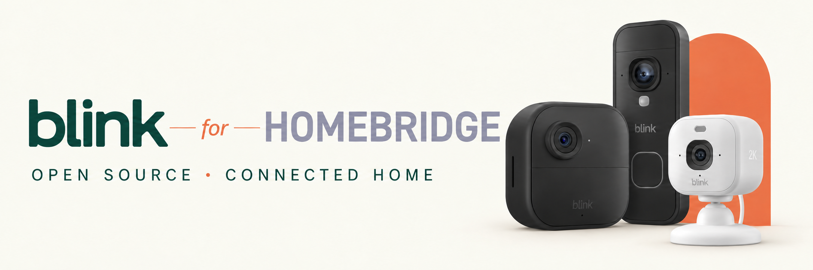

# @sealad886/homebridge-blink-cameras-new-api

Last reviewed: 4 November 2026.

[](https://www.npmjs.com/package/@sealad886/homebridge-blink-cameras-new-api)
[](LICENSE)
[](https://github.com/sealad886/homebridge-blink-cameras-new-api/actions/workflows/test.yml)
[](https://codecov.io/gh/sealad886/homebridge-blink-cameras-new-api)

## What's new — upcoming, unreleased

The next candidate adds **automatic HomeKit Secure Video import from completed
Blink USB clips**, guided per-camera setup and recording progress/recovery, and
Node.js 22/24/26 support. Saved-clip recording avoids an idle recording feed;
continuous recording remains a separate opt-in. The new activity panel separates
Blink capture time, preparation, Home offer and transport acknowledgement.

These changes are not in the current npm `1.0.0-beta3`. That published version
already ships the five-target protocol-3 media worker and continuous HSV
integration. The upcoming USB path uses protocol 4; a normal candidate and full
automatic existing-camera/Home acceptance are still required. Start with the
[recording guide](https://github.com/sealad886/homebridge-blink-cameras-new-api/blob/main/docs/RECORDING.md)
for the new workflow and its limits. The
[qualification record](https://github.com/sealad886/homebridge-blink-cameras-new-api/blob/main/docs/audits/2026-11-04-hsv-readiness-qualification.md)
separates local tests, real provider/Pi results and Home acceptance.

> Important: This plugin uses Blink's private OAuth and REST APIs. All APK-known
> production regions use the same production OAuth host; geography changes only
> the REST tier discovered after token issuance. Only an EU-region account has
> live-account evidence. Non-EU accounts are not live-validated and remain covered
> by Android 57.1 APK traces plus automated routing tests.

Modern Blink platform plugin for Homebridge using Blink-hosted OAuth. Exposes Blink devices as proper HomeKit accessories:

- **SecuritySystem** for arm/disarm control of networks
- **MotionSensor** for motion detection events
- **Doorbell** service exposed for doorbell devices; automatic ring delivery is not implemented
- **Switch** for enabling/disabling motion detection per device
- **Camera** live video/audio and snapshots, with an optional manual snapshot-refresh switch
- **Opt-in HomeKit Secure Video** with continuous capture in published beta3;
  completed-USB-clip import is part of the upcoming candidate above
- **Connection monitor and retry control** for provider outages
- **Optional TemperatureSensor** for traditional cameras reporting temperature;
  default off, with global and per-device settings

The current static API catalog is recovered from Blink Android 59.2
(`versionCode` 29823413), with Android 57.1 retained as the comparison and
bounded live-evidence baseline. See the [API contract](https://github.com/sealad886/homebridge-blink-cameras-new-api/blob/main/docs/api-contract/README.md). Blink can
change these private interfaces without notice.

## Contents

- [Features and supported devices](#features-and-supported-devices)
- [Requirements](#requirements)
- [Installation](#installation)
- [Sign-in and account verification](#sign-in-and-account-verification)
- [Configuration](#configuration)
- [Using the plugin in Apple Home](#using-the-plugin-in-apple-home)
- [Live streaming and quality](#live-streaming-and-quality)
- [HomeKit Secure Video](#homekit-secure-video)
- [Troubleshooting](#troubleshooting)
- [Documentation and development](#documentation-and-development)
- [Disclaimer and trademarks](#disclaimer-and-trademarks)

## Features and supported devices

- ✅ **Proper HomeKit SecuritySystem** - Arm/disarm networks using the Security System tile in Home app
- ✅ **Motion Detection** - Receive motion alerts in HomeKit when your cameras detect motion
- **Doorbell devices** - Motion controls, sensors and a HomeKit Doorbell service; see the ring-event limitation below
- ✅ **Status Polling** - Automatically syncs device states with Blink cloud
- ✅ **OAuth Authentication** - Modern OAuth 2.0 with automatic token refresh
- ✅ **Blink-hosted MFA** - Password and hosted MFA stay on Blink's sign-in page
- ✅ **Retry Logic** - Bounded retries for eligible reads, rate limits and server errors; ambiguous liveview/completion POSTs are not replayed

### Supported devices

| Blink Device | HomeKit Service | Features |
| ------------ | --------------- | -------- |
| **Network** | SecuritySystem | Arm/disarm all cameras in network |
| **Camera** | Switch + MotionSensor + optional TemperatureSensor | Enable/disable motion, motion events, reported temperature where available |
| **Doorbell** | Doorbell + Switch + MotionSensor | Enable/disable motion, motion events; automatic ring delivery unavailable |
| **Owl (Mini)** | Switch + MotionSensor | Enable/disable motion, motion events |

Doorbell devices expose a HomeKit Doorbell service, but the current runtime does
not connect incoming Blink ring events to it. Its presence does not establish
automatic ring notifications; use the official Blink app for those alerts.

Temperature sensing uses Blink's cached camera configuration metadata and does
not force a new physical measurement. Enabling it adds one bounded metadata read
per camera per normal state poll. Missing/offline readings produce a sensor fault;
Owl/Mini and doorbell temperature are not supported. See
[temperature configuration](https://github.com/sealad886/homebridge-blink-cameras-new-api/blob/main/docs/configuration.md#camera-temperature)
for global/per-device controls and sampling limitations.

#### SecuritySystem modes

The HomeKit SecuritySystem exposes standard modes:

- **Away Arm** → Network is armed
- **Stay Arm** → Network is armed (same as Away)
- **Night Arm** → Network is armed (same as Away)
- **Disarm** → Network is disarmed

Note: Blink only has armed/disarmed states, so all "armed" modes map to Blink's armed state.

## Requirements

- Homebridge 1.11.1 or later
- Node.js 22, 24 or 26 for this source revision (see [package engines](https://github.com/sealad886/homebridge-blink-cameras-new-api/blob/main/package.json))
- A Blink account
- For live streaming, the matching private codec worker supplied in the package; see [streaming requirements](https://github.com/sealad886/homebridge-blink-cameras-new-api/blob/main/docs/streaming.md#packaged-codec-requirements).

## Installation

### Via Homebridge UI (Recommended)

1. Open the Homebridge UI
2. Navigate to Plugins
3. Search for "@sealad886/homebridge-blink-cameras-new-api"
4. Click Install

### Via npm

```bash
npm install -g @sealad886/homebridge-blink-cameras-new-api
```

Restart Homebridge after installing.

## Sign-in and account verification

Use a desktop browser to open the plugin settings in Homebridge UI and choose **Sign in securely with
Blink**. Enter credentials and hosted MFA only on Blink’s page, then return the
complete callback address through **Paste Blink Result and Finish**. Complete
any distinct post-token verification requested by Homebridge.

Follow the [sign-in and recovery guide](https://github.com/sealad886/homebridge-blink-cameras-new-api/blob/main/docs/authentication.md) for the full
procedure, clipboard fallback, session storage and known validation boundaries.
Never put passwords or verification codes into plugin settings.

## Configuration

Plugin settings have five sections: **Overview & connection**, **Cameras in
Home**, **HomeKit recording**, **Live viewing & sound**, and **Advanced &
troubleshooting**. Choose cameras from discovery rather than entering IDs.
Account maintenance and diagnostic recording are under Advanced. In the upcoming
recording panel, selected-camera activity appears first; setup instructions open
for first use and remain available afterwards.

Edits remain a draft until you click Homebridge’s **Save**. Save closes settings
and offers the normal restart workflow; restart the Blink child bridge to apply
changes. Camera selections or a successful connection check do not establish
that Apple Home has allowed recording or saved a clip.

The [configuration reference](https://github.com/sealad886/homebridge-blink-cameras-new-api/blob/main/docs/configuration.md) owns defaults, manual
JSON examples, exclusions, naming overrides and snapshot settings. The
[UI schema](https://github.com/sealad886/homebridge-blink-cameras-new-api/blob/main/config.schema.json) defines selectable fields and validation.

## Using the plugin in Apple Home

### Identifying camera controls

Each camera, doorbell and Mini/Owl control starts with the device name assigned
in the plugin (including a configured device-name override):

| Home service | Example |
| --- | --- |
| Enable or disable motion detection | Test Camera Motion Detection |
| Read-only motion sensor | Test Camera Motion Sensor |
| Request a snapshot, then automatically return Off | Test Camera Refresh Snapshot |
| Doorbell service (automatic ring delivery unavailable) | Test Doorbell Doorbell |
| Network arm/disarm | Example Network Security |

The camera tile retains its assigned device name. Long names reserve space for
the control's purpose within HomeKit's name limit. Existing service identities
remain unchanged, preserving pairings and automations. The plugin updates both
Name and generated Configured Name on its controls when loading existing accessories,
while preserving a different Home-assigned Configured Name;
Home may retain a separate user-assigned name or cached tile label. Those labels
can be edited in Home without removing or pairing the accessory again. A name
chosen only in Home is not available to the plugin as a prefix for other services;
set a device-name override in the plugin for a consistent prefix throughout.

## Live streaming and quality

Live video and audio use the packaged private codec worker. Output quality is system-wide; input quality
is per camera. The default preserves automatic selection. Optional 720p/15 and
640×360/15 profiles reduce encoding work; 1080p/30 increases it. Smoothness depends
on the installed host and source; synthetic tests do not establish playback.

See [streaming and quality](https://github.com/sealad886/homebridge-blink-cameras-new-api/blob/main/docs/streaming.md) for codec requirements, profiles,
2K input, software encoding, transport guards and known security limitations.

### Two-way talk status

Talkback remains disabled. See the [talkback guard](https://github.com/sealad886/homebridge-blink-cameras-new-api/blob/main/docs/streaming.md#two-way-talk-status).

## HomeKit Secure Video

Choose cameras explicitly in **HomeKit recording**, Save and restart the Blink
child bridge, then allow recording in Apple Home. Existing camera accessories
gain recording support; normal setup does not require a second test camera.
Home manages recording permissions, the compatible home hub and iCloud+ plan.
Clips are reviewed in Home's recording history, not as iCloud Drive files.

The upcoming default **Saved Blink clips** source imports completed native Sync
Module USB recordings. Native **Local Storage** differs from daily **Cloud Clip
Backup**; USB connection or armed status alone does not prove a usable source.
Wait for the camera's initial clip scan before triggering a fresh test event.
If Blink produces no native clip, there is no footage to import.

Saved replay is delayed. Find the resulting Home event around its offer/import
time, then play it and export important clips. An offer or acknowledgement is
transport evidence, not iCloud-retention confirmation. Native clip/retrigger gaps
remain, and bounded queues can skip expired Home copies while Blink originals
remain. The plugin is not a permanent archive.

Continuous mode keeps a feed and prebuffer running while recording is allowed,
using battery even without motion. Saved mode avoids that idle recording feed;
manual Live View, including opening a Home camera tile, and Refresh Snapshot can
still use battery. See the
[recording setup, first test and recovery guide](https://github.com/sealad886/homebridge-blink-cameras-new-api/blob/main/docs/RECORDING.md)
for per-module choices, observed Home status, source eligibility, capacity and
Home playback/export. See also
[Apple's HomeKit Secure Video guide](https://support.apple.com/en-ie/guide/icloud/mme054c72692/icloud).

## Troubleshooting

Use the [troubleshooting guide](https://github.com/sealad886/homebridge-blink-cameras-new-api/blob/main/docs/troubleshooting.md) for connection faults,
recovery, motion, rate limits and runtime checks. Use
[bounded diagnostics](https://github.com/sealad886/homebridge-blink-cameras-new-api/blob/main/docs/debug_logging_spec.md) when collecting evidence.
HomeKit bridge audit entries are logged at INFO with an explicit UTC datetime and
camera/accessory name, including motion detections and clears, characteristic
requests/results, and camera control lifecycles. Debug mode is not required.
A cached snapshot or a Live label alone does not prove sustained video/audio.

## Documentation and development

The [documentation map](https://github.com/sealad886/homebridge-blink-cameras-new-api/blob/main/docs/README.md) identifies the canonical owner for
each topic and separates current guidance from historical evidence.

- [Contributing and local testing](https://github.com/sealad886/homebridge-blink-cameras-new-api/blob/main/CONTRIBUTING.md)
- [Vendor API contract and generation](https://github.com/sealad886/homebridge-blink-cameras-new-api/blob/main/docs/api-contract/README.md)
- [Architecture decisions](https://github.com/sealad886/homebridge-blink-cameras-new-api/blob/main/docs/adr/README.md)
- [Release, installation, rollback and acceptance](https://github.com/sealad886/homebridge-blink-cameras-new-api/blob/main/docs/RELEASE.md)
- [Security findings and delivery ledger](https://github.com/sealad886/homebridge-blink-cameras-new-api/blob/main/docs/plans/security-hardening.md)

## Changelog

See [CHANGELOG.md](CHANGELOG.md) for current release notes and migration history.

## License

The JavaScript plugin is MIT - see [LICENSE](LICENSE). Native worker development
sources are GPL-3.0-or-later; see [native/COPYING](https://github.com/sealad886/homebridge-blink-cameras-new-api/blob/main/native/COPYING) and the pinned
dependency notices under [native/dependencies](https://github.com/sealad886/homebridge-blink-cameras-new-api/blob/main/native/dependencies/README.md).
Published beta3 includes its five matching native workers and corresponding
source. Changed protocol-4 workers require their own complete package and
qualification before distribution.

## Credits

- API documentation derived from reverse engineering the Blink Android app
- Homebridge platform plugin architecture
- EU-region hosted, Android-refresh, REST-bootstrap, and restart evidence;
  non-EU accounts are not live-validated and remain APK-derived plus
  mocked/parameterized pending authorized validation

## Disclaimer and trademarks

This is an independent, unofficial community project. Neither the developer nor
this project is affiliated with, endorsed by, sponsored by, or otherwise
associated with Immedia Semiconductor, LLC or any of its affiliates, Amazon.com,
Inc. or any of its affiliates, or the Homebridge project and its contributors.

Blink, Amazon, Homebridge, Apple, HomeKit, and other product names, trademarks,
and logos mentioned in this documentation belong to their respective owners.
Their use is solely to identify products, services, and compatibility; it does
not imply endorsement or an official relationship.

This plugin uses privately documented interfaces that may change or become
unavailable without notice. Compatibility and continued access are not
guaranteed. The plugin is not a substitute for the official Blink app or a
professionally monitored security system. Software is provided under the terms
of the applicable [license](LICENSE), including its warranty disclaimer.
