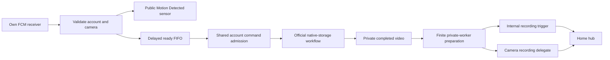

# ADR-007: Event-driven native recordings for HomeKit Secure Video

Date: 9 November 2026

Status: implemented locally; host verification and independent review passed.
An owned receiver has received a fresh native motion event. Full installed-plugin
and physical HomeKit acceptance remain separate gates in the
[evidence ledger](../plans/event-driven-hsv-redesign.md).
This supersedes the motion polling decision in [ADR-002](002-motion-detection.md).

## Problem and evidence

Native camera-to-Sync-Module recording is the primary service. The operator
reports normal recording after rolling Homebridge back to v0.10.0. The preserved
HSV source adds recurring native-storage preparation and can lose unfinished
command ownership. Three offline reproductions demonstrate twenty manifest
preparations in ten idle minutes and replacement preparations after pending or
lost-acknowledgement timeouts. They establish source defects, not the physical
cause of the persistent recording outage.

The new worktree starts from stable v0.10.0,
`fb42ef207077b06565cd024a6db86143d640a276`. The committed HSV reference
`c9228033747468f23d804ee6dfa789db8ec39b11` and its separately preserved dirty
files remain reference material. The discarded diagnostic branch has a private
recovery bundle. None is a runtime dependency of this design.

The tablet-installed Blink 61.0 APK, version code 29859371, was acquired with its
split artifacts and hashes. This establishes the installed tablet version,
not the newest release worldwide. The [APK protocol audit](../audits/2026-11-09-blink61-recording-protocol.md)
records the actual JADX/DEX evidence and limitations. REA's Android operation was
unavailable because the caller-supplied JADX MCP JAR was not configured; no
successful REA Android Evidence IDs are claimed.

The beta integrates current main's secure live-view runtime, settings and verified
native packaging before publication. Finite downloaded MP4 input is a closed mode
of the same private codec worker; previous worker artifacts are rejected. The
original stable-based component test results remain separately identified.

The working Pi remains on 0.10.0. Source development and these documents do not
install a candidate, restart Homebridge or authorize speculative camera/storage
recovery commands. Operational tests need their own recorded scope and evidence.

## Decision and canonical owners

Use one platform-owned pipeline. Provider notifications report public motion
immediately and independently schedule native clip jobs. Completed downloads
leave provider ownership before local media preparation and Home delivery.

There is no edge from HomeKit motion, a recording request, a snapshot retry or a
local conversion callback into provider acquisition.

| Responsibility | Canonical implementation |
| --- | --- |
| Client-side push identity and verified Google transport | `src/blink-api/fcm/` |
| Payload time/device interpretation and catalog matching | `motion-events.ts`, `native-clip-matcher.ts` |
| Event deduplication, delay, ready order and retry limits | `NativeRecordingCoordinator` |
| Exact preparation/status/result protocol and durable operation receipt | `NativeStorageOwner` |
| Account-wide admission for storage, controls and manual Live View | Existing `BlinkApi` command queue and combined remote-operation ownership |
| Scoped persistence and composition with discovered devices | `NativeRecordingRuntime`, using the existing owner-only JSON writer |
| Finite local conversion and Home transport lifecycle | `native-recording-preparation.ts`, canonical private codec worker, `NativeRecordingDelegate` |
| Configured policy and HomeKit service assembly | `native-recording-config.ts`, platform and existing `MotionBase` |

These boundaries retain different necessary lifetimes: Google transport,
recording demand, accepted provider operations and local Home delivery. They do
not create a second Blink HTTP client, a continuous recording feed or another
account command queue.

## Own motion subscription without Firebase administration

The receiver uses public Firebase app/project parameters recovered from the
installed APK. It creates and privately retains its own Google identity and
receiver credentials; it needs no Firebase console account, service-account key,
privileged sender credential or copied phone/tablet token. The authenticated
Blink update is one JSON POST to the current client's regional
`/clients/{clientId}/update` route, using `app_version`, `os_version`,
`client_name` and `notification_key`. The client ID comes from the current auth
cache. Scope is checked again after asynchronous authentication and immediately
before dispatch. An unchanged token does not trigger another Blink update.

One account receiver serves either consumer: any exposed motion sensor OR any
camera configured for HomeKit recording. Motion-only operation creates no USB
jobs. HSV-only operation keeps the receiver active when the public sensor is
hidden. Neither option changes Blink arming, motion enablement or video quality.
The public sensor name is `<camera display name> Motion Detected`; the existing
MotionSensor service subtype and accessory identity are retained.

The pinned `@eneris/push-receiver` 4.4.0 supplies registration and protobuf/ECE
codecs. Its default unbounded retry/socket behavior is not used. A bounded Node
worker receives only Google configuration and its own credentials, performs
Google-only registration within a request/deadline budget, and connects to
`mtalk.google.com:5228` with hostname and certificate verification. Parent/worker
messages, protocol frames and pending notifications are bounded. Source stop,
disable, epoch changes and reconnect fence late callbacks and disabled-period
backlog. Google ACK follows durable downstream handoff and message-ID storage.

Web Push transport identity and Firebase project identity are separate. Decrypt
an encrypted message with the owned receiver keys, then require its inner FCM
envelope's `from` to match the configured Blink sender before extracting data.
Do not reject it because the outer MCS sender is a Web Push/VAPID transport
identity. Plaintext native data still requires an exact outer project sender.
Wrong or missing inner senders, invalid payloads and ciphertext/key mismatches
expose no application data. The scoped primary-source trace is recorded in the
[protocol audit](../audits/2026-11-09-blink61-recording-protocol.md#web-push-transport-and-project-identity).

The isolated worker sets IPv4-first DNS ordering before registration/connection,
retaining IPv6 and automatic family selection. Importing the worker does not
change the Homebridge process's DNS settings. This responds to observed
automatic-family timeouts where verified IPv4 connects succeeded; it introduces
no hardcoded address, certificate bypass, extra account request or UI flag.

The receiver component registered and connected; Blink acknowledged its own-client
binding with HTTP 200. The corrected decoder subsequently authenticated fourteen
real native-motion messages, including a fresh event durably accepted after its
activation boundary. The first qualification used an explicit IPv4 diagnostic
connection after automatic-family transport timeouts. The final production
worker then reconnected and durably accepted another fresh native motion event
with its isolated DNS policy and no socket/frame override. An installed full Pi
runtime remains a separate gate.
The [ledger](../plans/event-driven-hsv-redesign.md#provider-evidence) records the
exact scope and remaining physical gates.

An owned Android notification-listener relay remains a fallback design if direct
consumer delivery cannot be qualified. It would require explicit device access,
reliable notification identity/time semantics and authenticated local delivery.
No relay is installed, and no generic Blink SSE/webhook endpoint is claimed.

## Validate observations and match actual catalog metadata

Native USB notifications use `category=motion`, `event_type=cam2sm_motion` and
camera/target/network/`created_at` fields. The notification handler does not itself
prepare USB media or establish a saved clip. Native jobs require a real,
unambiguous discovered Sync Module association. `cloud_motion` can report public
motion without a network field or Sync binding; it does not schedule native USB
work. The app's early-media signal is not treated as proof of completed storage.

Account/client/tier come from the authenticated receiver context. Optional wire
scope fields must agree when present. Resolve raw provider IDs and exact targets
`camera`, `owl` and `doorbell` against the existing inventory. Reject ambiguous,
foreign, malformed or unsupported observations rather than querying settings
for each event. Notification `created_at` is an offset-bearing instant; it is
not a measured physical PIR or completed-file timestamp.

The inspected USB catalog exposes `network_id`, native `device_name`, clip ID,
`created_at` and an opaque media URL. Match a unique canonical camera/time
candidate within configured tolerance; reject duplicate native names or equal
candidates. Home display aliases do not identify physical clips. Do not invent a
filename timestamp from an API URL. Full explicit-offset timestamps establish
the actual comparison; unsupported time-only filenames cannot substitute.

Later homescreen discovery refreshes the complete native matching inventory,
including excluded cameras, and the eligible motion consumer bindings. Changes
to camera identities, native names, networks or Sync Module associations replace
the runtime after its pending local work drains. The handoff discards old media
and preserves the accessory's HomeKit configuration and privacy choices.
Ordering and ordinary status changes reuse the runtime. Unresolved remote
obligations retain their original finite local lease across handoff and restart.
Expiry records local abandonment, preserves uncertainty, and permits later
distinct work without declaring remote completion. New HomeKit accessories still follow the platform's existing
registration lifecycle and may require a child-bridge restart.

## Delayed jobs, fairness and bounded reuse

Each distinct provider event receives its own delayed job; repeated delivery of
one event is deduplicated before acquisition. The defaults are a 60-second
initial delay, five-second missing retry and ten retries after the first attempt.
They are configurable plugin policies, not Blink timing guarantees.

Use a bounded ready FIFO. Select the first currently eligible job in queue order
and persist it at the head before dispatch. A terminal missing result moves that
job to the tail with its next eligibility time. A camera waiting for its clip or
local capacity cannot block another ready camera. One active or unresolved
operation still blocks all provider dispatch; fairness never bypasses that fence.
Expire undispatched old jobs and report exhaustion/capacity rejection visibly.
A local expiry never completes an accepted remote operation.

Reuse an already completed scoped catalog for a positive match. A missing retry
must respect the separate per-module catalog preparation cooldown, default
60 seconds. Five-second eligibility is not permission to prepare a new manifest
every five seconds. The cooldown is conservative policy, not a measured vendor
rate limit. An explicit catalog or selected-clip POST refusal applies the same
per-module deferral before another attempt, including a cached positive match.
Clip deduplication uses account/module/clip/native-camera/capture
identity independently of changing manifest IDs. Do not infer that nearby
notifications share a clip without sufficient capture evidence.

Local pressure defers new optional work. Source files are bounded individually
and in the owned cache; each camera has at most one prepared/active recording.
Cached control, Live View and storage ownership also defers queued jobs locally,
without consuming an attempt or issuing a provider probe. A definite admission
race requeues within the existing retry/age bound; strict no-send proof restores
the prior catalog cooldown, while a sent/refused POST retains its cooldown.
One shared conversion admission and an explicit retained-media budget prevent
unbounded concurrent local preparation. Bounds on owned buffers are not a claim
about total Homebridge or native-worker RSS.

## Preserve provider ownership and minimize requests

Storage, explicit settings/capture commands and manual Live View use the
canonical account admission. Persist intent before a new operation POST and
persist the accepted command identity before status reads. A local deadline,
cancellation, network error, malformed acknowledgement, restart, exhausted status
budget or failed GET cannot establish remote completion. Local exclusion is
bounded to 120 seconds or the earlier action/job deadline and is never renewed
by retries or restart. At expiry the uncertain job is abandoned, not retried;
new distinct work may proceed through normal provider conflict handling.
Per-module receipts survive shared account-state writes. Legacy receipts without
a lease are advisory rather than a permanent veto. Late results cannot revive
abandoned work or replace a newer owner.

A typed HTTP refusal of a new POST is different: a 4xx response other than 408,
before an accepted identity exists, does not create a new command owner. Retain
a durable refused receipt and count the wire attempt. A local no-send rejection
is recorded separately as `not-started`. This distinction preserves cooldowns.
A refused status GET is never proof that the preceding POST was refused.

| Workflow | Added Blink requests |
| --- | --- |
| No new motion or outstanding obligation | Zero HSV catalog, clip, live-view or thumbnail-capture requests |
| New/rotated owned push token | One current-client metadata POST; none for unchanged tokens |
| Catalog preparation | One empty POST, at most 30 total known-parent status GETs at two-second spacing, then one first-child catalog GET on success |
| Selected clip | One empty POST, at most 30 total known-command status GETs, then one validated provider-returned file GET on success |
| Ordinary accepted command | Its existing workflow, with a durable total status-read ceiling of 60; deadline expiry retains uncertainty without an indefinite local veto |
| Startup recovery | At most one remaining-budget GET per known pending command; no replacement POST, catalog/file retrieval or guessed `/done` |
| Local conversion, HAP callbacks and cache expiry | No new acquisition requests |

Status success requires `complete=true` and numeric `status=0`; nonzero numeric
terminal status is failure. Parent, child, manifest and clip IDs are separate.
Follow the actual catalog `/local_storage/media/{firstChildId}` route and
validated selected media URL. Preserve opaque query data without forwarding
credentials to another origin or following redirects. No extra homescreen,
settings or USB-status preflight, post-download verification or storage `/done`
request is introduced. Ordinary explicit control workflows remain separate.

Automatic snapshots for native-recording cameras only download an existing
thumbnail on cache miss. An explicit manual refresh may still request a capture
through the same account owner. The native recording path uploads no video,
thumbnail or data file to Blink; documented control/workflow JSON POSTs remain
supported.

## Finite local media and Home privacy

Validate and read the completed private file through its owned descriptor, then
feed bounded MP4 bytes to the canonical packaged codec worker. Its finite mode
uses a closed seekable memory input after END; it accepts no filename, provider
URL or protocol-opening capability. H.264/AAC-LC output is validated as finite
fMP4 with contiguous keyframe fragments and bounded output/deadlines. Protocol 4
requires newly built, source-bound workers rather than previous artifacts.
The development lock selects Homebridge 1.11.1 / HAP 0.14.0; the running Pi's
newer Homebridge/Node environment is a separate runtime qualification.

HAP's [0.14.0 recording delegate](https://github.com/homebridge/HAP-NodeJS/blob/v0.14.0/src/lib/controller/CameraController.ts#L200-L307)
accepts initialization and media packets, not a URL/file-import command. Announce
internal recording motion only after local preparation, then answer the Home
hub's request with paced finite packets and one final marker. Public PIR motion
remains immediate. A hub ACK establishes transport acknowledgement, not iCloud
retention, historic timeline insertion or true pre-event video.

Capture Home recording/camera/audio policy before acquisition and recheck it
through download, preparation, offer and stream. Revocation cancels local demand
and media, fences late completion and prevents disabled-period replay. Keep any
already accepted provider obligation for minimal safe reconciliation. Policy
changes do not clear remote owners or change Blink settings.

Scoped state and receiver credentials use one serialized durable writer under an
owned private directory with 0600 files. Dispatch/transition diagnostics are
local; generating a diagnostic report must not issue verification requests.
Push diagnostics retain only fixed event/reason/disposition labels and bounded
retry delay. Binding/readiness is informational, faults and required recovery
are warnings, and other transitions are debug detail.
Private provider URLs and credential-bearing state are not public logs or UI data.

## Remaining acceptance boundaries

The ledger owns final combined test/review receipts, exact artifact identity and
physical acceptance. Required physical evidence separates actual provider motion,
new USB clip contents, bounded retrieval, Home request/transport and retained,
playable Home recording. Static APK traces and local suites cannot prove the
original outage's cause or continued native recording under the candidate.

The app's native live-view shutdown bytes remain unresolved; this acquisition
design does not use continuous Live View. A failed manual view retirement remains
owned until supported terminal evidence is available. Private protocol changes,
unmeasured motion-to-file timing and delayed Home retention remain explicit
limits rather than speculative recovery traffic.
