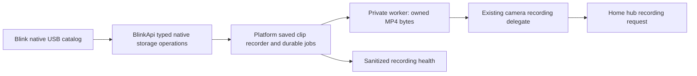

# Native saved clips as a HomeKit Secure Video source

Status: accepted for local implementation by the operator's 3 November 2026
approval; physical acceptance and release remain separate.

## Context

The existing recording delegate starts continuous native-worker capture whenever
Home permits recording. The isolated saved-file experiment proved that a completed
native clip can be retained and played by Home, but its private conversion and
manual control are not production ingress. The operator now requires low idle
camera activity, automatic replay and bounded recovery without changing existing
camera pairings. Native clip length/retrigger gaps, delayed ingestion and Home's
own retention decisions remain limits.

## Decision

Extend the existing camera recording delegate and native worker. Add one platform
owner for clip discovery and durable jobs. Do not create a second camera
controller or import diagnostic scripts into production.

The alternative is to retain continuous capture alone. It supplies real pre-event
footage and earlier motion but does not satisfy idle battery requirements. A
second recording accessory would duplicate pairing, policy and camera identity.
An external FFmpeg subprocess would bypass the established worker I/O authority.
Those alternatives are not selected.

## Recording source and configuration

- Add `hksvSource: 'saved-clips' | 'continuous'`, default `saved-clips` for selected
  `hksvCameras`. Unselected cameras do not gain recording capabilities.
- Add `syncModuleRecording` entries keyed by actual `syncModuleId`, with optional
  `source` and `pollIntervalSeconds` overrides. Default polling is 30 seconds;
  supported range is 15–300 seconds. Reject duplicate or invalid module IDs.
  Existing `syncModuleFeedLimits` continues to govern live feeds separately.
- Missing modules remain visible/removable in the existing unresolved-settings
  treatment. A camera in an ambiguous multi-module association receives a clear
  unavailable state until identity can be resolved; do not guess its physical path.
- Extend `scripts/migrate-secure-media-config.cjs` with a preview-first conversion
  that backs up the source before writing explicit source mode/settings. Preserve
  explicit continuous selections and unrelated settings. Do not silently rewrite
  the operator's live Homebridge configuration during plugin startup.

`src/platform.ts` remains the configuration and component-lifetime owner. Its
configuration interface, schema and custom UI must share the enum/defaults.

## Native storage API and identity

Add strict types/parsers in `src/blink-api/local-storage.ts`; keep authenticated
operations on `BlinkApi` in `src/blink-api/client.ts`:

1. Request a manifest with the existing shared REST client and persist returned
   request/command identity before polling.
2. Retrieve the same manifest request until it produces a catalog or the absolute
   deadline expires. A pending HTTP-success response is not a failed recording.
3. Prepare a selected clip using its current manifest and clip identity. Persist
   this context before polling; after restart try its prepared GET before issuing
   another preparation POST.
4. Download only the matching prepared relative route using a bounded binary GET
   added to `BlinkHttp`. Reuse authentication headers, cancellation/deadlines and
   redaction. Reject redirects; do not accept arbitrary absolute media URLs.

The working route sequence is manifest POST, manifest-request GET, matching clip
POST and that prepared clip GET. The retained Android `/local_storage/media/`
route must not replace this sequence without provider evidence.

Account, network, module and device IDs use existing numeric ID validation.
Manifest/request/clip IDs are treated as bounded validated opaque path components,
encoded individually. Do not coerce them through floating-point identifiers.
Each admitted job retains the complete account/network/module/camera/clip tuple,
capture time, provider size and manifest request context. Its stable deduplication
key excludes the replaceable manifest generation and includes capture time to
defend against reused clip IDs.

The verified native catalog's `size` is a KiB-scale estimate, not an exact byte
count: a value of 5,073 accompanied a complete 5,194,528-byte prepared response.
Keep this estimate explicitly labelled. Enforce the actual 32 MiB body cap and
HTTP completion/content-length checks, then persist the actual length and hash
used for file admission and preparation. Reserve the full bounded source
allowance before downloading so estimate variance cannot exceed storage bounds.

Some catalogs expose only an alphanumeric `camera_name`. Prefer explicit numeric
device ID or serial when present. Otherwise resolve only a unique token of the
original provider camera name within the exact network/module. Never use a Home
display-name override. Reject collisions, unmatched names, rename ambiguity and
cross-network identity rather than replaying footage through the wrong camera.

Catalogs may contain 1,000 unsorted entries. Scan every returned entry and do not
claim the response is complete history. The implementation uses overlapping full
catalog observations and clip deduplication, not the cloud motion timestamp cursor.

Primary sources: [current BlinkPy API](https://raw.githubusercontent.com/fronzbot/blinkpy/dev/blinkpy/api.py),
[current BlinkPy Sync Module flow](https://raw.githubusercontent.com/fronzbot/blinkpy/dev/blinkpy/sync_module.py),
and the retained [Android contract](../api-contract/blink-59.2-29823413.md).

## Durable jobs, startup and resource bounds

Add `src/native-clip-recorder.ts`, owned once by the platform. It owns catalog
observations, job transitions and fair scheduling across registered eligible
cameras; it does not own HAP policy or native decoding.

Initial operational bounds are two preparations globally on hosts with at least
four logical CPUs, one on smaller hosts, and one download per module,
64 queued jobs globally, 16 per camera, 32 MiB per original/prepared file and
128 MiB aggregate owned media on disk. Keep existing 32 MiB per-camera and 64 MiB
aggregate in-memory recording budgets. These are admission limits, not measured
capacity guarantees. Jobs expire after 15 minutes; command attempts have one
120-second absolute deadline and bounded retry delays of 1, 5, 15 and 30 seconds,
at most five attempts and always within job age. Respect provider retry guidance.
The primitive four-core Pi profile suggested the two-worker ceiling: two preparations
completed in 49.041 seconds versus four in 91.187 seconds, with higher latency
and temperature at four. Admission remains subject to reservations; this does not
establish sustained multi-camera acquisition throughput. Those runs used preset
1 (`ultrafast`); the canonical helper uses preset 0 (`veryfast`). Canonical-path
Pi qualification subsequently completed two canonical preparations in 69.589
seconds, below the 120-second processing deadline, with preserved source
timestamps and released budgets. These separate-process measurements qualify
native preparation; shared coordinator accounting and sustained collection are
verified separately.

Reserve room for the source and the maximum next prepared output before starting
a download. Include reservations and actual retained/pinned files when admitting
work across modules; downloading originals must not fill the store and prevent
preparation. A serial fair job lifecycle is sufficient: concurrency limits are
maxima, not a requirement to overlap download and preparation.

Persist an owner-only versioned ledger and use the existing secure JSON atomic
write pattern under the plugin storage root. Keep only relative task-owned media
names and validated metadata; never persist credentials or capability URLs.
Record durable state before side effects. Use partial-download names and atomic
promotion only after a complete bounded response; recompute the source hash.
Never treat a partial file as prepared media. On restart reconcile ledger/files,
account all existing owned bytes and reject unsafe symlinks or ownership changes.
Reclaim only terminal, unpinned, task-owned files according to explicit retention;
never remove native clips, pairing state, unrelated files or `.DS_Store`.

The first successful catalog establishes a persisted baseline: record all returned
clip identities as already observed without replaying account history. Preserve
this initialized state across restart. Thereafter newly observed identities are
eligible when within the fixed activation boundary and maximum age; catalog
overlap handles delayed appearance without moving a wall-clock cutoff forward.
A newly selected module/camera establishes its own baseline. Resetting history is
an explicit operator action, not a retry response.

Bound metadata as well as media: at most 2,048 seen identities per module, 8,192
globally and a 4 MiB ledger. Prune only terminal identities whose capture age is
already beyond the 15-minute replay eligibility window. A reappearing pruned clip
is rejected by age, so pruning cannot cause a replay. Keep the startup activation
boundary and initialized marker independently of tombstones. Never evict an
eligible or nonterminal identity to make room; report metadata pressure and stop
new admission until safe reclamation is possible. Catalog baseline writes must be
atomic, with a clear capacity error if all returned identities cannot be recorded.

States are `queued`, `preparing-download`, `downloading`, `preparing-media`,
`ready`, `offered`, `delivered`, `uncertain`, `failed`, `expired` and `cancelled`.
Pending commands retain their context. Queue pressure is visible and does not
silently discard the newest clip. A final offer/ACK is transport evidence only.
After a crash around an offer, retain `uncertain` rather than automatically
duplicating a possibly saved Home event. Exactly-once iCloud persistence cannot be
claimed because Home offers no corresponding confirmed-retention API here.

## MP4 ingress under the native worker authority

Extend the private protocol to version 4 with 18 u32 CONFIG fields (72 bytes).
Field 16 is the explicit input-format enum (MPEG-TS 0 or finite MP4 1); field 17 is
the audio-tail policy (strict 0 or bounded silence 1, finite MP4 recording only).
MP4 is recording-only and requires END before
decoding. The worker stores at most 32 MiB owned bytes and exposes a seekable custom
AVIO over that memory. It receives no filename, URL, caller options or filesystem
handle. For MP4, force the MOV demuxer, deny secondary opens, leave protocol access
empty and disable external data references/absolute paths. The existing worker
watchdog, output budgets, timestamp/geometry/codec validation and no-CLI contract
remain in force. MPEG-TS live input keeps its existing stream behaviour.

Before finite MOV parsing, limit individual libavutil allocations to 64 MiB with
the public allocation API and allow at most two streams. MOV sample tables can
otherwise allocate from declared counts before the decoded-frame/duration checks.
This is a per-allocation and stream-count guard, not a hard aggregate RSS ceiling.
Use a safely capped synthetic admission regression plus genuine/max-geometry
checks; do not rely on `max_index_size`, which this MOV allocation path bypasses.

In finite MP4 mode, input credit means safely copied into the bounded owned input
buffer so feeding can complete before END. It must not wait for demuxer reads and
deadlock the parent. Source limits and explicit END distinguish input acceptance
from successful decoding. Native tests pin protocol version, format enum,
malformed/truncated input, seek bounds, secondary-open denial, cancellation,
oversize admission and final decoder/encoder flushing. The TypeScript
`PrivateMediaWorker` validates the new status/configuration and exposes a typed
finite-input option; no runtime fallback to mismatched binaries is permitted.

Add `src/accessories/saved-clip-preparation.ts` to feed admitted file bytes through
that worker and retain validated fMP4 using existing recording budgets. Generate a
bounded preview in the same isolated worker if needed, rather than an external
media executable. Preserve the original. For native short audio tails, allow only
an explicitly requested, bounded normalization policy inside finite-file ingress:
append labelled silence to the observed video end before unchanged recording
coverage checks. Reject missing/interior audio and excessive gaps. Record generated
sample count and source/prepared hashes. Do not fabricate video frames or relax
live-source discontinuity rules.

Diagnose the observed single-picture omission with counts at source packet,
decoded picture, cadence selection, encoded output and final mux boundaries.
The selected output frame-rate policy can intentionally sample higher-rate input;
tests must distinguish that negotiated policy from an unexplained EOF omission.
Profile and optimize measured preparation without weakening constraints. A new
protocol requires all-target artifacts, source archive and qualification before
distribution; local testing does not authorize release.

Finite MP4 decoding begins after END, so its parent media-drain processing budget
is a fixed 120 seconds from accepted END. Streaming MPEG-TS retains its existing
two-second drain deadline, and the worker's 300-second lifetime cap remains.
Readiness must be available before finite input is fed to avoid a startup deadlock.
Output type 14 supplies a bounded 32-byte summary: six u32 values for decoded,
selected and encoded video counts, generated audio samples, audio rate and input
format, followed by a u64 `preparedSpanUpperBoundUs`. In MP4 mode this is the muxed
packet-timeline span plus one explicit AAC padding block, bounded to 92 seconds;
it is a conservative motion-hold bound, not exact container duration. MPEG-TS
does not emit this finite summary, preserving its existing continuous contract.
The explicit tail policy allows at most two seconds of generated silence, counted
before AAC encoder padding; it does not relax missing/interior audio checks.

## Existing camera delegate and idle behaviour

Extend `BlinkCameraRecordingDelegate` in `src/accessories/camera-recording.ts` with
source mode and a finite saved-clip admission API. In saved mode, permission and
configuration changes register readiness with the coordinator and never call the
live `startSession`. `videoMotionActive` applies only to continuous mode. The
platform cloud poller may still report configured native motion, but must not
announce a saved-mode HSV event before the complete file is ready.

Snapshot the exact Home video/audio configuration for preparation. Changing it
before trigger invalidates that preparation. Revoking recording, camera or audio
permission aborts pending work and media promptly and fences late callbacks. Never
replay disallowed jobs when permission returns. A registered camera disappearing,
or a source-mode change terminally retires affected jobs. Ordinary shutdown pauses
known pre-offer work for restart; work already offered becomes uncertain and is
not automatically replayed. Recording/camera/audio permission generations are
separate from ordinary selected-configuration revisions. Configuration
renegotiation alone must not continually establish new privacy cutovers or erase
otherwise eligible jobs. A disabled recording period is never retroactively
uploaded when recording returns.

For a finite bundle, retain and pin its initial prefix before appending later
fragments so the rolling prebuffer cannot evict the beginning. Complete bounded
preparation before publishing replay motion through the existing motion service.
Serve initialization and every contiguous fragment, with exactly one final marker.
Default to the physically accepted instant delivery plus explicit prepared-span
motion hold; this is a starting policy that still requires production acceptance.
Retain prompt cancellation and normal HAP timeouts. Do not claim that pacing or
ACK causes Home retention. Adjacent clips remain separate queued events; no gap
filling or synthetic continuous incident is implied.

The planned motion hold is independent of ACK or ordinary HDS closure. A verified
prototype run retained the full Home clip despite an unacknowledged CANCELLED
close, so that close is transport uncertainty rather than evidence of recording
failure. Release media/pins under their unchanged timeouts while the bounded
motion hold finishes; do not automatically offer the same clip again. Recording,
camera or audio revocation, source disable and shutdown still clear motion and
retire the event promptly.

In `src/accessories/motion-base.ts`, retain the existing controller and pairings.
Keep explicit manual live viewing available. In `camera-source.ts`, automatic
saved-mode snapshot requests use an existing clip preview or existing thumbnail
GET/cache only and never issue a thumbnail-capture POST on cache expiry. Explicit
manual Refresh Snapshot remains a separate operator action. Show truthful capture
age; do not present an old preview as current. Native catalog polling does not
arm/disarm cameras or change motion settings.

## Health, UI and acceptance

Expose source mode, queue count, last catalog, native capture, download,
preparation, offer/delivery and failure timestamps through the existing custom UI
server. Return sanitized summaries scoped to included cameras/modules; never raw
provider IDs/URLs, media or authentication. Native capture time and replay time
must remain distinct. Show idle/no recent clip separately from failed acquisition;
armed/online is not proof of recording. The system cannot infer a PIR failure from
an absence of clips alone.

The UI and operator documentation explain delayed Home timestamps/notifications,
native clip/retrigger gaps, no historical insertion, no true pre-event footage in
saved mode and the additional battery cost of explicit continuous mode. The
selected recording source applies independently of live-view visibility.

Required ordered implementation slices and their acceptance are:

1. Diagnostic Stop/storage/status regressions pass before source changes advance.
2. Native finite-MP4 ingress passes forced-format/isolation/limits and faithful
   sample-boundary tests; representative original counts explain any omission.
3. Typed native API tests cover pending requests, malformed/cross-device catalog
   data, bounded binary response, redirects and request-context recovery.
4. Durable coordinator tests prove first-catalog baseline, repeated/late catalogs,
   restart, dedupe, fair queue pressure, expiry and permission cancellation.
5. Existing-accessory integration tests prove zero idle live/thumbnail capture,
   complete finite delivery, final marker, cancellation and no duplicate events.
6. Settings/migration/health tests verify validation, effective source selection,
   backup-before-write and truthful output. Run contributor checks and bounded
   independent spec and code review on frozen recording-flow changes; native and
   API source reviews are already complete.
7. Root-led Pi acceptance measures source-to-prepared fidelity, stage timings,
   queue growth, idle camera activity and multi-camera capacity; export actual
   Home clips for retention proof. No publication or production installation is
   included in this architecture decision.
## Readiness contract extension — 4 November 2026

The approved readiness work reuses the canonical resolver, coordinator and
recording delegate. One platform-owned composed `version: 2` health report
replaces recorder-only publication, so all selected cameras are represented even
when unavailable, unresolved, excluded or continuous-only. The recorder remains
the sole ledger/media owner; its post-persistence activity notification must not
weaken the durable pre-offer fence. No new provider client, recorder, archive or
recording timer is introduced for the GUI.

The report contains an applied `settingsRevision`, runtime state, module baseline
states/timestamps, bounded resource totals and per-selection rows. A shared pure
revision/projection helper beside the existing resolver includes recording
selection/source/module overrides, exclusions and audio gating, never credentials.
The same revision is returned by settings validation. A pending draft or differing
desired/applied revision cannot display a ready-to-test state; valid Save remains
independent of missing, stale or unsupported report data.

Each selected row includes stable identity/label, selection status, effective
source, module association, canonical availability/reason, observed Home state,
baseline state, progress and action reason. Preserve unresolved saved selectors
instead of silently dropping them. Native storage mode remains unverified until there is fresh native evidence.
A fully downloaded newly eligible post-baseline USB job may expose
`native-clip-observed` and its evidence time from the existing ledger. This is
source availability evidence, not operator-walk confirmation or Home retention.
Baseline/catalog entries, USB presence and the raw `local_storage_enabled` field
alone are not proof.

`BlinkCameraRecordingDelegate.getHomeRecordingObservation()` separates raw Home
observations from effective policy. Configuration is unknown, not-configured,
configured or invalid; recording/camera/audio booleans and trigger types are null
until observed. Preserve raw Home audio separately from the plugin's effective
audio gate. First equal-value callbacks must publish an observation without
unnecessary epoch churn. Accept actual boolean/0/1 characteristic values only;
`undefined` must not become observed false through coercion.

Baseline completion comes from each camera's durable initialized state after a
successful catalog, not a recent timestamp. A new camera waits for its own first
successful observation. Module readiness requires all its current registered
selections to have initialized; unavailable selections are not applicable.
Per-job captured/discovered/downloaded/prepared/offered/acknowledged/expiry times
remain attached to one coherent job. Preserve a last-expired explanation after
ordinary terminal pruning. Retention is always unconfirmed by the plugin.

State precedence is report/revision applicability, selection/source availability,
known Home denial or unknown configuration/policy, unsupported trigger policy,
then baseline and job progress. A fresh-test prompt requires valid observed Home
configuration, observed recording/camera permission, supported motion and that
camera's completed baseline. Audio off is valid video-only policy. The final
step remains manual Home playback/export confirmation, never inferred from ACK.

Ring-only saved recording is rejected as `unsupported-trigger-policy` before
preparation and the offer fence. An explicit transition between motion allowed
and denied is a permission/cutover change: cancel/fence work and dedupe observed
off-policy clips so they cannot upload later. Preserve the last valid motion
policy across temporary missing configuration during ordinary renegotiation;
codec-only changes remain configuration revisions. No automatic ring feature
or relaxed privacy behavior is added.

The UI's existing bounded authenticated local health route reads only this
report. Version-1/invalid reports receive explicit restart/unavailable guidance,
not a compatibility adapter. Module/camera progression and plain safe recovery
actions use bounded shared reasons. They do not change camera settings, trigger
capture or automatically replay uncertain offers. Missing/stale reports do not
block a valid configuration save.
