# How Blink becomes an Apple Home camera

[Documentation home](README.md) · [Illustrated setup](../output/articles/set-up-blink-cameras-in-apple-home/index.md) · [Recording checklist](configuration.md#recording-setup-checklist)

Last reviewed: 16 November 2026 · Source edition: `2.0.0-alpha.0` (prerelease).

This guide describes the 2.0 prerelease source. The published 1.1.0 used a
packaged codec backend; its acceptance does not qualify this changed backend.

Homebridge connects your Blink account to Apple Home. This plugin discovers
devices, publishes HomeKit accessories, and translates controls and media.
Blink supplies camera feeds and native recordings. Apple Home controls its camera
permissions and recording history.

## Live viewing and recording take different paths

| Use | What starts it | Video source | What to expect |
| --- | --- | --- | --- |
| **Live viewing** | Open a camera in Home | An explicit Blink live feed, converted by externally installed FFmpeg | View the camera now. Opening a feed can wake the camera and use battery. |
| **HomeKit recording** | A motion push schedules work for a recording-enabled camera | A completed native Sync Module USB motion clip | Download, preparation and Home delivery happen after capture. No idle recording feed is started. |

Recording is **off by default**. Enable it per camera in plugin settings, Save,
and restart the Blink child bridge. Then allow recording separately in Home.
Both paths use the camera's existing Home accessory; enabling recording does not
create a replay camera or replace live viewing.

Live viewing and recording require a separately installed **FFmpeg 6.1 or later**
with the [required media capabilities](streaming.md#packaged-codec-requirements).
The package retains a libSRTP-only protection and launch helper; it does not
bundle FFmpeg codecs. Check the Homebridge service's executable discovery or
configure `ffmpegPath` before testing video.

The plugin's camera-audio setting affects both paths. Home also has a separate
recording-audio permission. Video-only recording is valid. Live output quality
presets do not set Home's recording format; explicit camera input quality changes
Blink's persistent quality setting too. See [quality settings](streaming.md#input-and-output-quality).

## Follow the video

```mermaid
flowchart TB
  subgraph live[Live viewing]
    direction LR
    H[Open camera in Home] --> L[Blink live feed]
    L --> W[External FFmpeg converts media]
    W --> V[Live video and audio in Home]
  end
  subgraph saved[Native recording]
    direction LR
    M[Blink motion push arrives] --> Q[Schedule native clip lookup]
    Q --> U[Completed USB clip is matched and downloaded]
    U --> P[External FFmpeg prepares clip]
    P --> O[Clip offered to Home hub]
    O --> C[Verify saved playback in Home]
  end
```

The plugin owns its authenticated push receiver. You do not need a Firebase
console project or a phone's notification token. Motion-sensor exposure and
recording are independent: either one can keep the shared receiver active.
Normal status polling does not prepare USB catalogs or determine push timing.

The recording path needs actual **native Local Storage** clips. Daily Cloud Clip
Backup is a different Blink feature. A connected drive, an armed system or a
cloud clip alone does not establish a usable recording source. Confirm a fresh
clip plays in Blink's Local Storage list before testing Home delivery.

## Understand the delay

Each motion observation schedules a bounded job for its camera. The normal first
lookup starts after 60 seconds. If the matching native clip is not available,
local retries and a per-module catalog cooldown can add delay. Matching requires
authoritative camera identity and timestamps; the closest recording is not
necessarily the same event.

Early Notification can affect when motion arrives relative to clip completion.
Its **Force on**, **Force off**, and **Leave unchanged** settings manage Blink's
preference; they do not guarantee immediate footage. Keep inherited defaults for
first setup and use the [scheduling reference](configuration.md#clip-matching-and-scheduling)
when investigating a measured mismatch.

After preparation, the plugin offers a finite recording to Home. The hub decides
whether to request and retain it under your permissions. Its timeline can show
delivery time rather than the original capture time. This path does not establish
pre-event recording or arbitrary historical insertion.

## Check the three permission layers

| Layer | What you control | First verification |
| --- | --- | --- |
| **Blink** | System arming, camera motion and native storage | A fresh native clip plays in Blink. |
| **Plugin** | Camera inclusion, motion visibility, per-camera recording and shared audio | Save settings and restart the Blink child bridge. |
| **Apple Home** | Camera access, Home/Away recording modes, event filters and recording audio | Allow Stream & Allow Recording in each desired mode; use Any Motion first. |

Home's **When Home** and **When Away** choices are separate. Home determines the
active mode from household location information. **Stream** alone allows viewing;
notifications alone do not allow recording. Check **More Options**, Activity Zones
and **Record Audio** for each camera. Follow the [recording checklist](configuration.md#recording-setup-checklist).

## Read evidence at the right stage

A successful connection test establishes that Blink accepted the stored session
for that check. A motion event establishes an observation. A downloaded native
file establishes source availability. A preparation or transport receipt
establishes progress toward Home delivery.

Only opening the saved event and letting playback advance establishes that the
particular recording is present and playable in Home. A notification, thumbnail,
live-view label or transfer acknowledgement cannot establish that result.

The host keeps temporary working media for processing and delivery, then removes
it at a terminal result. It is not a recording backup. Original Blink clips
remain on Blink storage; keep important footage using the relevant export
controls. Recoverable faults may use bounded media repair, including disclosed
replacement silence when original audio cannot be recovered. Home's audio-off
permission remains respected.

## Know the current limits

- Two-way talk and automatic Blink doorbell ring delivery remain unavailable.
- Saved Home playback was observed for two tested cameras with the 1.1.0 codec
  backend. The changed 2.0 external backend requires fresh physical acceptance;
  verify your own installed package and settings.
- Native capture/retrigger gaps, matching failures, expiry, resource limits and
  Home's retention decisions can prevent a saved Home copy.
- Blink's private interfaces can change. Current live-account evidence is limited
  to an EU account; authentication and release qualification have their own gates.

Continue with [illustrated setup](../output/articles/set-up-blink-cameras-in-apple-home/index.md),
[configuration](configuration.md), [troubleshooting](troubleshooting.md), or the
[one-time migration guide](native-recording-config-migration.md). The
[release guide](RELEASE.md) owns exact-package and physical acceptance.
