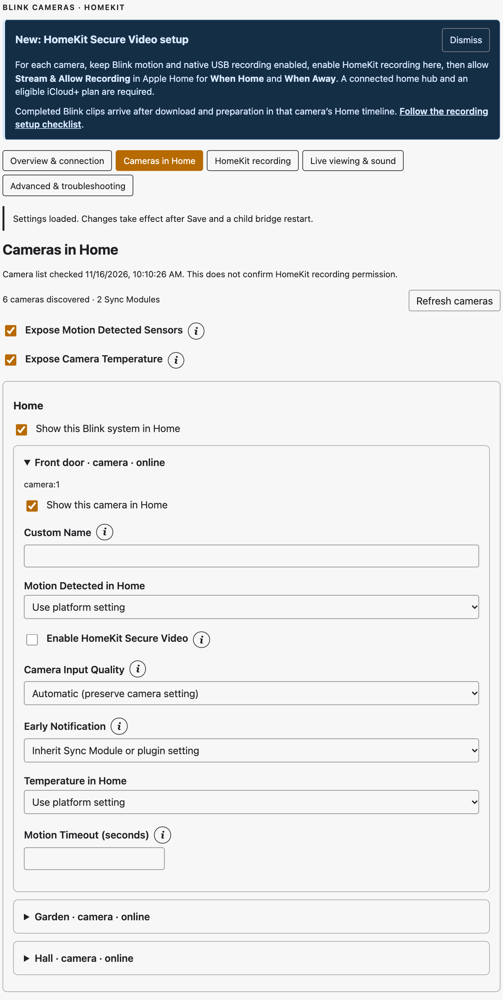
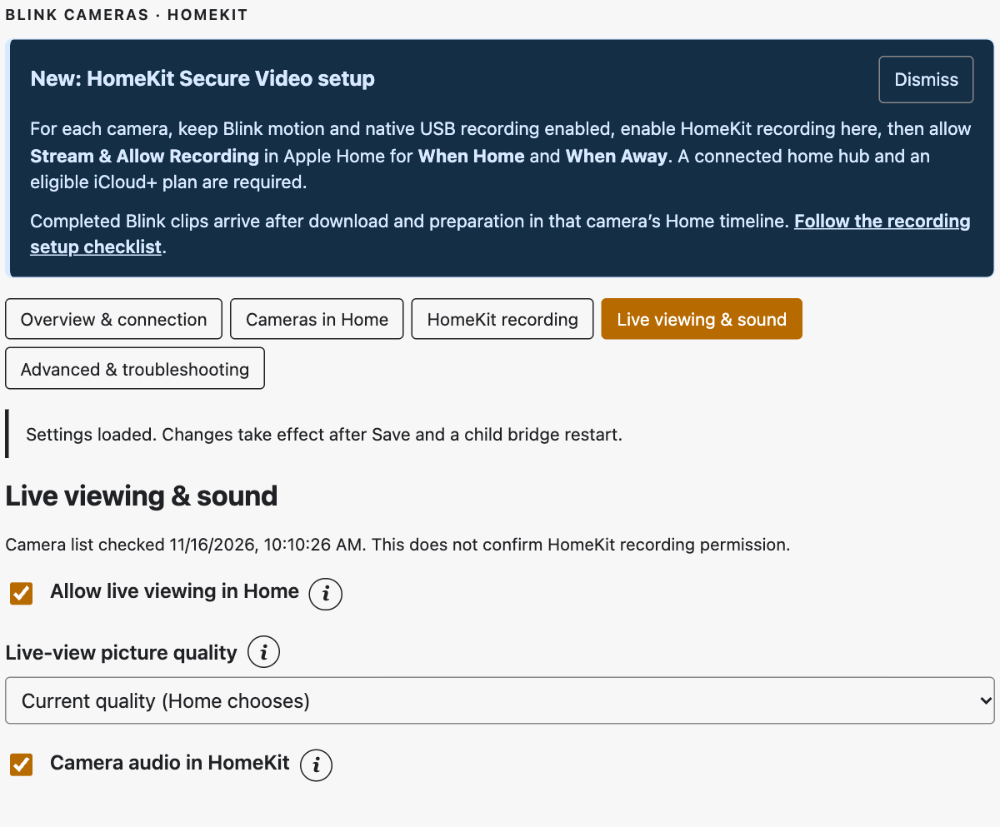
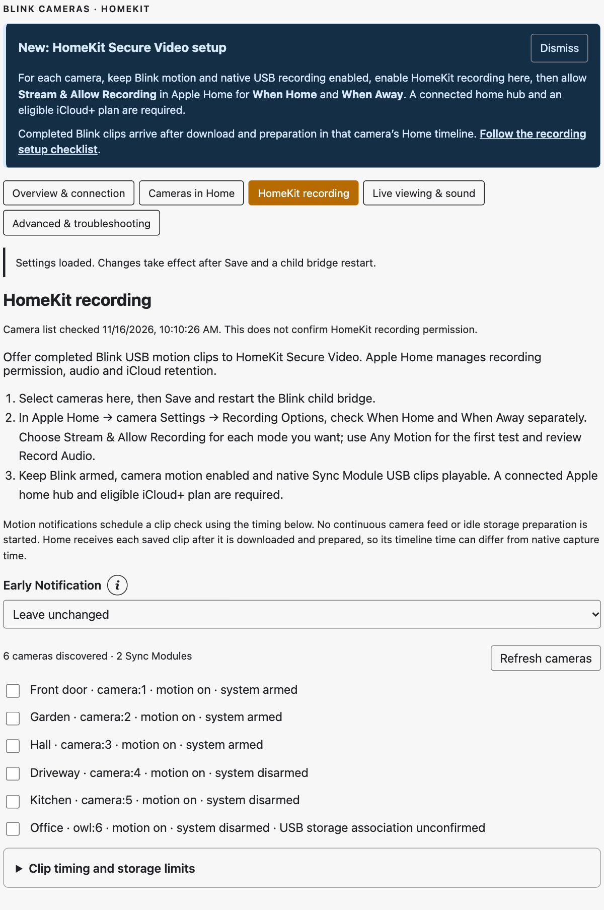

# Set up Blink cameras in Apple Home

[Documentation home](../../../docs/README.md) · [How it works](../../../docs/how-it-works.md) · [Troubleshooting](../../../docs/troubleshooting.md)

Connect Blink to Apple Home, verify live viewing, and test a native recording
in the camera's saved timeline.

**Source edition:** `1.1.0` · **Last reviewed:** 16 November 2026

Select the intended published version when installing; an unversioned installation
does not select a prerelease automatically. Screenshots use the actual UI with
synthetic data, not a connected account or camera acceptance test.

> **Before you begin:** HomeKit recording is off by default. It imports completed
> native Blink USB clips after download and preparation. A motion notification or
> transport acknowledgement does not establish saved Home playback. Two-way talk
> and automatic Blink doorbell ring delivery remain unavailable.

## 1. Check your installation

You need:

- **Homebridge 1.11.1 or later**, with access to its web UI.
- **Node.js 20.3 or later within 20.x, or Node.js 22, 24 or 26**, including the
  runtime used by the Blink child bridge.
- A Blink account and desktop browser for hosted sign-in.
- For video, the package's matching media worker for a
  [supported host](../../../docs/streaming.md#packaged-codec-requirements).
- For recording, working native Blink **Local Storage** clips, a compatible Home
  hub and an eligible iCloud+ plan for your camera count.

In Homebridge UI, open **Plugins**, search for
`@sealad886/homebridge-blink-cameras-new-api`, and install your intended version.
Restart Homebridge and open settings. See [installation](../../../README.md#installation)
for command-line and prerelease selection.

**Upgrading?** Read the [one-time migration guide](../../../docs/native-recording-config-migration.md)
first. It covers stable 0.10.0, intermediate betas, backups and Windows conversion.
The converter previews unless explicitly applied; supported automatic conversion
uses the installer's storage path. New setup needs no legacy conversion.

## 2. Connect your Blink account

Keep the Homebridge settings tab open:

1. Choose **Sign in securely with Blink**. If the new tab is blocked, use
   **Open Blink Sign-In**.
2. Enter credentials and complete hosted MFA only on Blink's page.
3. At the desktop **Unsupported Browser** page, copy the entire address from the
   browser's address bar. It begins with
   `https://applinks.blink.com/signin/callback`.
4. Return to Homebridge and choose **Paste Blink Result and Finish**. If clipboard
   access is denied, reveal the manual field, paste the complete address, and
   choose **Finish with Pasted Address**.
5. Complete any separately labeled **client verification** or **account
   verification** requested after tokens exist. This code is distinct from hosted
   MFA.
6. Wait for stored-token connection verification before continuing.

Never put passwords or verification codes in plugin configuration. Treat the
callback address as sensitive; clear the clipboard if automatic cleanup is denied.
A mobile device may open the Blink app instead of leaving a copyable callback.
Use the [authentication guide](../../../docs/authentication.md) for recovery and
its validation boundaries.

## 3. Choose the cameras you want in Home

| Section | Your task |
| --- | --- |
| **Overview & connection** | Inspect stored-session status and test the connection. |
| **Cameras in Home** | Include cameras, choose names, and configure motion, temperature and camera overrides. |
| **HomeKit recording** | Select recording cameras and review prerequisites, timing and storage limits. |
| **Live viewing & sound** | Allow live viewing and audio, and choose picture quality. |
| **Advanced & troubleshooting** | Adjust status polling, previews and diagnostics; manage the account. |

Start in **Cameras in Home** and choose from discovered devices. A per-camera
name override gives controls a consistent prefix; changing a name only in Home
does not rename its other services.

*Example devices show where to choose inclusion and names. Your discovery list
will differ. Motion-sensor visibility and recording enablement are separate.*

Click Homebridge's **Save**, then restart the Blink child bridge. Navigation keeps
drafts; selections and connection tests do not apply them. Save or discard drafts
before account-maintenance actions.

Add an unpaired child bridge through Homebridge's normal pairing flow. Keep
existing pairings: recording uses the same camera accessories, rooms and
automations, with no separate replay camera.

## 4. Verify live video, audio and snapshots

Open **Live viewing & sound**. Live viewing and camera audio default to enabled;
keep automatic picture selection for your first check. Save and restart after
changes.

*Plugin audio applies to live viewing and recording; Home controls recording
audio separately.*

Check changing video and current sound in Home, then close and reopen the camera.
A cached picture or “Live” label does not prove sustained playback.

Snapshots normally use a 60-second cache. Persistent caching keeps the last
image until a refresh request; the **Refresh Snapshot** switch returns Off even
when its attempt fails. For native-recording cameras, automatic requests read the
existing thumbnail without requesting capture. The explicit refresh switch can
still request a new capture. Busy-camera fallback may return an existing image.

If video stutters, change one setting at a time. Lower live output profiles can
reduce encoding work. Home negotiates recording format separately. Explicit
per-camera input quality changes Blink's persistent camera quality too; returning
to `auto` does not restore the previous value. See
[quality settings](../../../docs/streaming.md#input-and-output-quality).

## 5. Enable native clip recording

First confirm that a fresh motion clip plays in the Blink app's **Local Storage**
list for the camera's Sync Module. Daily Cloud Clip Backup, a connected drive, or
a cloud clip alone does not establish that source. Without a completed native
clip, the plugin has no recording to offer.

In **HomeKit recording**, select one camera, Save, and restart the child bridge.
Recording defaults to off for every camera. The plugin receives Blink motion push
notifications and schedules acquisition of completed clips; it starts no idle
recording feed or recurring storage preparation. Ordinary state polling is a
separate setting.

*The setup panel selects cameras and explains prerequisites. Example state does
not establish permission or playback in Apple Home.*

Keep **Early Notification** at **Leave unchanged** unless you intend to manage
Blink's preference. **Force on** and **Force off** can change when notifications
arrive, but neither guarantees faster clip availability. The normal initial lookup
delay is 60 seconds; queueing, catalog cooldown and missing-clip retries can add
time. See [timing and Early Notification](../../../docs/configuration.md#early-notification-and-clip-scheduling)
before tuning it.

## 6. Test one fresh recording

Complete the [recording checklist](../../../docs/configuration.md#recording-setup-checklist)
for each camera:

1. In Blink, keep the system armed, camera motion enabled and native Local Storage
   working.
2. Confirm the camera's **HomeKit recording** selection was saved and the child
   bridge restarted.
3. In Home, open the camera's **Settings → Recording Options**. Check **When Home**
   and **When Away** separately. Choose **Stream & Allow Recording** for every
   mode where you want recordings. **Stream** alone permits viewing.
4. Under **More Options**, choose **Any Motion** for this first test. Specific
   motion types and Activity Zones can exclude an event. Choose **Record Audio**
   separately; audio off is valid video-only recording.
5. Check that the Home hub is connected and the iCloud+ plan supports your camera
   count. Trigger fresh motion, then confirm its finished native clip plays in
   Blink.
6. Allow download and preparation, then open the saved event under that same
   camera in Home. Let playback advance beyond the thumbnail; check the beginning,
   middle and end.

Home chooses Home/Away mode from household location information. An Away-only
recording choice will not record while Home considers someone at home. Notification
settings and **Motion Detected** sensor visibility do not grant recording permission.

## 7. Review and keep important footage

Look around delivery time as well as Blink capture time. Delayed offers do not
insert footage at arbitrary historical points. Clip length comes from Blink's
recording, not the motion-sensor timeout.

Export important saved clips through Home. The plugin is a temporary processing
and delivery host, not an archive. It removes its local working source after
processing reaches a terminal result; Blink originals remain on Blink storage.
Recoverable media faults may use one bounded salvage pass. If usable video is
recovered with replacement silence, logs identify degraded audio; Home audio-off
permission still produces no audio track.

Saved Home playback was observed for two tested cameras. Verify your own
installation after setup or upgrade: that evidence does not qualify every camera or clip.

## If a step does not work

| What you see | Next check |
| --- | --- |
| Sign-in or verification stalls | Follow [account recovery](../../../docs/authentication.md); distinguish hosted MFA from post-token verification. |
| Settings appear unapplied | Save, restart the Blink child bridge, then reopen settings. |
| No native clip in Blink | Resolve Blink capture and Local Storage first. |
| Motion arrives but Home has no recording | Check per-camera Home/Away permission, Any Motion, clip matching and preparation using [recording troubleshooting](../../../docs/troubleshooting.md#motion-arrives-but-no-home-recording-appears). |
| A Home offer has no playable saved event | Check delivery time and playback manually; retain sanitized timestamps and avoid repeating an uncertain offer. |
| Live video fails or stutters | Close Home viewers, check the camera in Blink, then follow [streaming troubleshooting](../../../docs/troubleshooting.md#live-video-fails-stutters-or-stops). |

Use [bounded diagnostics](../../../docs/debug_logging_spec.md) for a report. Keep
tokens, callback addresses, private identifiers and footage out of public issues.
See [release acceptance](../../../docs/RELEASE.md) and the
[authentication boundaries](../../../docs/authentication.md#validation-boundary).
